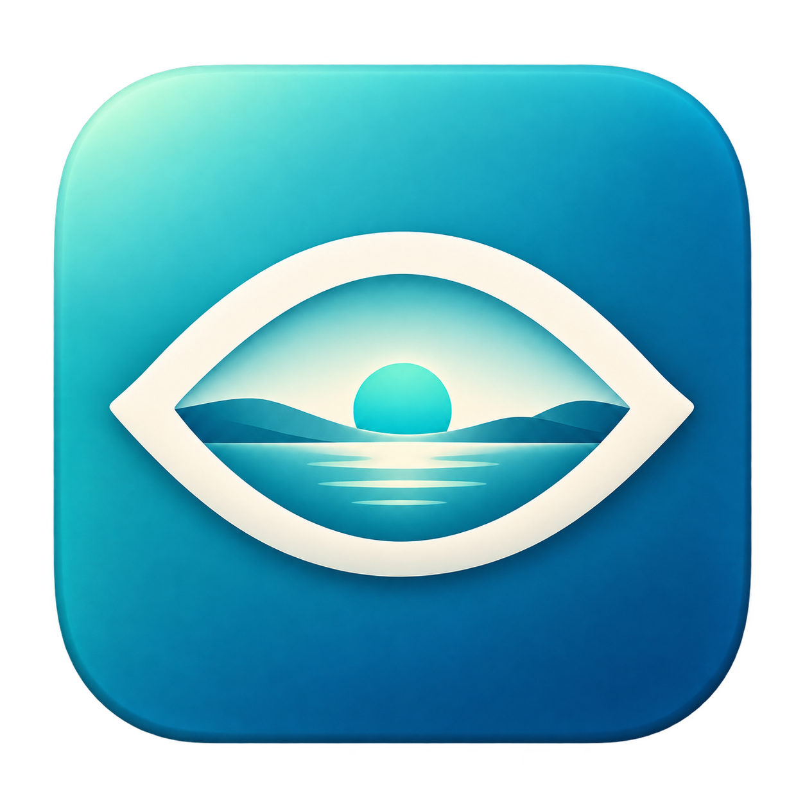

<p align="center"></p>

# FarLook

A lightweight, local macOS menu bar app that reminds you to look into the distance for **30 seconds** after **30 minutes** of continuous computer use.

[中文说明](README.md) · [Contributing](CONTRIBUTING.md) · [Changelog](CHANGELOG.md)

## Install

Download `FarLook-v0.2.0-macOS-arm64.zip` from this repository's **Releases**, unzip it, and move the app into Applications. Open it to see the eye symbol and remaining time in the menu bar. No persistent Dock icon is shown.

Requires **Apple Silicon and macOS 13 or later**. Built and checked on macOS 26.3.1; other versions, fullscreen apps, and multiple displays need further field testing. The app is ad-hoc signed, not Apple notarized. If macOS blocks it, review and build the source or follow the system's Privacy & Security prompts. Do not disable Gatekeeper. Launch at login is not configured.

## How continuous use is measured

- Input-free pauses shorter than **2 minutes** count toward the current 30-minute session.
- At 2 minutes without keyboard/mouse input, the session resets and waits for input.
- Locking the screen, sleep, display sleep, or switching users resets the session.
- At 30 minutes, a reminder appears. Start a 30-second break or postpone for 5 minutes.
- An optional sound signals the end of the break. The next input begins a new session.
- Choose a 2-, 5-, or 10-minute idle threshold, or ignore idle time and reset on lock/sleep and breaks.

Reading and video playback can involve no input. Under the default rule, they reset the session after 2 minutes; choose another rule if this does not fit your workflow. The countdown cannot verify that you looked away. This is a reminder, not gaze tracking or a claim of medically validated benefit.

## Privacy

No network access, camera, input-content capture, app-usage logging, or activity history. Only input idle duration and session/sleep events are read. Idle and sound preferences stay on your Mac. No Accessibility, Screen Recording, or Camera permission is required.

## Feedback

Use **Issues** for bug reports and feature requests; templates accept English or Chinese. Use **Discussions**, once enabled for the repository, for open-ended ideas. Pull requests are welcome; see [CONTRIBUTING.md](CONTRIBUTING.md). Avoid sharing private files or full-desktop screenshots. Response times and acceptance of suggestions are not guaranteed.

## Build and check

Requires Xcode or Xcode Command Line Tools. No third-party runtime dependencies.

```sh
zsh scripts/test.sh
zsh build.sh
open build/远眺一下.app
```

The default build targets arm64. macOS `sips` and `iconutil` generate the ICNS from the included PNG. Timing is sampled once per second. Lock detection uses system notification conventions alongside documented sleep/session notifications. See [VERIFICATION.md](VERIFICATION.md) for tested and untested cases.

## License

[MIT](LICENSE).
